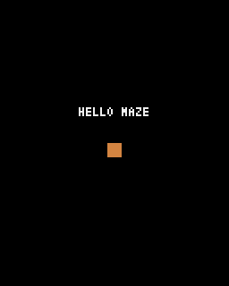

# 第1章 画面を出す：Pyxel は「更新」と「描画」を1秒に何十回もくり返す

この章では、黒い画面に文字とオレンジの四角を出します。見た目は地味ですが、ゲームを動かす土台になるしくみが全部入っています。



## コードを書く

`main.py` に次のように書いて、実行してください。

```python
import pyxel


class App:
    def __init__(self):
        pyxel.init(128, 160, title="SLIDE MAZE")
        pyxel.run(self.update, self.draw)

    def update(self):
        pass

    def draw(self):
        pyxel.cls(0)
        pyxel.text(44, 60, "HELLO MAZE", 7)
        pyxel.rect(60, 80, 8, 8, 9)


App()
```

ウィンドウが開いて「HELLO MAZE」と四角が出れば成功です。

## Pyxel のプログラムの形

Pyxel のゲームは、だいたいこの形をしています。上から順に読んでいきます。

**`import pyxel`** で Pyxel の機能を使えるようにします。

**`class App:`** は、ゲーム全体をひとまとめにする箱です。この箱の中に書いた `def` を **メソッド** と呼びます。メソッドは、箱に入った関数のことだと思ってかまいません。

**`__init__`** は、`App()` と書いたときに1回だけ動く準備用のメソッドです。いちばん下の行の `App()` が、ゲームを始める合図になっています。

**`pyxel.init(128, 160, title="SLIDE MAZE")`** で、横128・縦160ドットの画面を作ります。パソコンの画面では小さすぎるので、Pyxel が自動で拡大して表示します。ドット絵のゲームはこのくらいの大きさで作るのが普通です。

**`pyxel.run(self.update, self.draw)`** がいちばん大事な行です。これを実行すると、Pyxel は

1. `update` を呼ぶ（ゲームの中身を1コマぶん進める）
2. `draw` を呼ぶ（今のようすを画面に描く）

の2つを、1秒間に30回くり返し始めます。この1回ぶんを **フレーム** と呼びます。パラパラ漫画の1枚と同じです。

役割はきっちり分けます。キーの判定やキャラクターの移動は `update` に書き、`draw` では絵を描くことだけをします。この教材のゲームも最後までこの分け方で作ります。

> **`pyxel.run` より後ろは実行されない**
> `pyxel.run` はゲームが終わるまで戻ってきません。そのため、`__init__` の中で `pyxel.run` より後ろに書いた行は動きません。準備の処理は必ず `pyxel.run` より前に書きます。

## self は「このゲーム自身」

メソッドの最初の引数 `self` は、「このゲーム自身」を指します。`self.x = 10` と書くと、ゲームに `x` という値を持たせることになります。

ふつうの変数は、関数が終わると消えてしまいます。`self.` を付けた変数は、ゲームが続くかぎり残ります。`update` で動かした位置を `draw` で使えるのは、このおかげです。第2章から `self.` 付きの変数がたくさん出てきますが、「フレームをまたいで覚えておきたい値には `self.` を付ける」と覚えておけば十分です。

## 座標と色

画面の位置は (x, y) の2つの数で表します。左上が (0, 0) で、**x は右へ、y は下へ** 行くほど大きくなります。数学のグラフとは y の向きが逆なので注意してください。

`draw` で使った命令は次の3つです。

- `pyxel.cls(0)`：画面全体を色0（黒）で塗りつぶす。毎フレーム最初に呼んで、前の絵を消す
- `pyxel.text(44, 60, "HELLO MAZE", 7)`：(44, 60) に文字を書く。色は7（白）
- `pyxel.rect(60, 80, 8, 8, 9)`：(60, 80) を左上にして、幅8・高さ8の四角を塗る。色は9（オレンジ）

色は0〜15の番号で指定します。どの番号が何色かは [付録の色番号表](appendix.md#色番号表) にあります。Pyxel に最初から入っている文字は英数字だけで、日本語は表示できません。この教材のゲームでも、画面の文字は英語にしています。

## 試してみる：四角を動かす

`update` が本当に何度も呼ばれているかを確かめてみます。次のように書きかえると、四角が右へ動いていきます。

```python
    def __init__(self):
        pyxel.init(128, 160, title="SLIDE MAZE")
        self.x = 60
        pyxel.run(self.update, self.draw)

    def update(self):
        self.x += 1

    def draw(self):
        pyxel.cls(0)
        pyxel.text(44, 60, "HELLO MAZE", 7)
        pyxel.rect(self.x, 80, 8, 8, 9)
```

`pyxel.cls(0)` の行を消して動かすと、どうなるでしょうか。前のフレームの絵が残り、四角が線のように伸びていきます。毎フレームの最初に画面を消す理由がわかると思います。

試し終わったら、元のコードに戻してから第2章へ進んでください。
