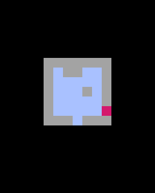

# 第2章 湖を描く：湖は文字で書き、grid[y][x] で1マスを取り出す

第1章では画面に四角を1つ描きました。この章では、その四角をたくさん並べて凍った湖にします。



## 湖を文字で書く

湖は、文字列のリストで書くことにします。

```python
MAP = [
    "#######",
    "# ##  #",
    "#     #",
    "#   # #",
    "#     #",
    "#     E",
    "###S###",
]
```

1文字が1マスです。使う文字の意味は次のとおりです。

| 文字 | 意味 |
| --- | --- |
| `#` | 岩、または湖のまわりの岸 |
| 半角スペース | 氷 |
| `S` | スタート |
| `E` | 向こう岸の町（ゴール。Exit の E） |

スタートと町は、湖のいちばん外側（岸）の列に置きます。手前の岸から出発して、湖を渡って向こう岸の町へ行くゲームだからです。

こうしておくと、湖の形がプログラムを見ただけでわかります。作り直したいときも、文字を書きかえるだけです。第5章からは、水 `~` やもろい氷 `x` の文字も増えていきます。

## コードを書く

`main.py` を次のように書きかえます。

```python
import pyxel

TILE = 8  # 1マスの大きさ（ドット）

MAP = [
    "#######",
    "# ##  #",
    "#     #",
    "#   # #",
    "#     #",
    "#     E",
    "###S###",
]


class App:
    def __init__(self):
        pyxel.init(128, 160, title="ICE LAKE")
        # 文字列のままだと書きかえられないので、1文字ずつのリストにする
        self.grid = [list(row) for row in MAP]
        self.h = len(self.grid)
        self.w = len(self.grid[0])
        # 湖を画面のまん中に置くための、左上の位置
        self.ox = (128 - self.w * TILE) // 2
        self.oy = 16 + (120 - self.h * TILE) // 2
        pyxel.run(self.update, self.draw)

    def update(self):
        pass

    def draw(self):
        pyxel.cls(0)
        for y in range(self.h):
            for x in range(self.w):
                tile = self.grid[y][x]
                px = self.ox + x * TILE
                py = self.oy + y * TILE
                if tile == "#":
                    pyxel.rect(px, py, TILE, TILE, 13)  # 岩（灰色）
                elif tile == "E":
                    pyxel.rect(px, py, TILE, TILE, 8)  # 町（赤）
                else:
                    pyxel.rect(px, py, TILE, TILE, 6)  # 氷（水色）


App()
```

実行すると、灰色の岩に囲まれた水色の氷と、赤い町のマスが出ます。

## 湖を「書きかえられる形」にする

`__init__` の最初にある次の行に注目してください。

```python
self.grid = [list(row) for row in MAP]
```

`list("#     E")` は、文字列を1文字ずつに分けたリスト `['#', ' ', ' ', ' ', ' ', ' ', 'E']` を作ります。この行は、`MAP` の各行にそれを行って、リストのリストを作っています。次のように書いたのと同じ意味です。

```python
self.grid = []
for row in MAP:
    self.grid.append(list(row))
```

わざわざ分けるのは、Python の文字列は一部だけを書きかえられないからです。このゲームでは、スタートの `S` を氷に変えたり、もろい氷が割れて水に変わったり、といった書きかえを行います。リストにしておけば `self.grid[6][3] = " "` のように1マスだけ変えられます。

`[... for ... in ...]` の書き方を **リスト内包表記** と呼びます。この先も何度か出てきます。

## grid[y][x] は「y が先」

1マスを取り出すときは `self.grid[y][x]` と書きます。最初の `[y]` で「上から何行目か」を選び、次の `[x]` で「その行の左から何文字目か」を選ぶので、**y が先** になります。

座標はふつう (x, y) の順に書くので、ここはよく間違えます。`self.grid[x][y]` と書いてしまうと、縦長や横長の湖で `IndexError` が出たり、湖が斜めにひっくり返って見えたりします。

## マスの番号を画面の位置に直す

`draw` では、二重の `for` ですべてのマスを順に見ていきます。

```python
for y in range(self.h):
    for x in range(self.w):
```

`self.h` は湖の行数、`self.w` は1行の文字数です。外側の `for` が行を1つ選び、内側の `for` がその行のマスを左から順に見ます。

マスの番号 `x` を画面の位置に直すのが次の式です。

```python
px = self.ox + x * TILE
```

1マスは `TILE = 8` ドットなので、`x` 番目のマスは左端から `x * 8` ドットの位置にあります。`self.ox` は湖の左端の位置です。

湖を画面のまん中に置くために、`self.ox` は次のように計算しています。

```python
self.ox = (128 - self.w * TILE) // 2
```

画面の幅128から湖の幅を引くと、余白の合計が出ます。それを2で割れば左側の余白になります。`//` は割り算の答えを整数にする記号です。画面の位置にはふつう整数を使うので、`/` ではなく `//` を使います。

縦の `self.oy` は、画面の上16ドットを文字を書く場所として空けておき、その下の高さ120ドットの中でまん中に置いています。

今はどのマスも、色を変えた8×8の四角で描いているだけです。雪の岸や、きらきらした氷のような見た目は、第11章で整えます。

## 試してみる：湖を作り変える

`MAP` を書きかえて、自分の湖を描いてみてください。行を増やしても列を増やしても、まん中に表示されます。

ひとつだけ守ってほしいことがあります。**すべての行を同じ長さにする** ことです。長さがそろっていないと、短い行の右端を読もうとしたときにエラーになります。

次の章では、この湖の上にプレイヤーを置いて動かします。
