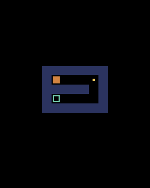

# 第3章 プレイヤーを動かす：となりが壁かどうかを調べてから進む

迷路が描けたので、スタート地点にプレイヤーを置き、矢印キーで1マスずつ動かせるようにします。滑る動きは次の第4章で作ります。



## コードを書く

```python
import pyxel

TILE = 8

MAP = [
    "#######",
    "#S   .#",
    "##### #",
    "#E    #",
    "#######",
]


class App:
    def __init__(self):
        pyxel.init(128, 160, title="SLIDE MAZE")
        self.grid = [list(row) for row in MAP]
        self.h = len(self.grid)
        self.w = len(self.grid[0])
        self.ox = (128 - self.w * TILE) // 2
        self.oy = 16 + (120 - self.h * TILE) // 2
        # "S" の場所をさがして、プレイヤーをそこに置く
        for y in range(self.h):
            for x in range(self.w):
                if self.grid[y][x] == "S":
                    self.x = x
                    self.y = y
                    self.grid[y][x] = " "  # S はもう要らないので床にする
        pyxel.run(self.update, self.draw)

    def is_wall(self, x, y):
        return self.grid[y][x] == "#"

    def move(self, dx, dy):
        # となりが壁でなければ1マス進む
        if not self.is_wall(self.x + dx, self.y + dy):
            self.x += dx
            self.y += dy

    def update(self):
        if pyxel.btnp(pyxel.KEY_UP):
            self.move(0, -1)
        if pyxel.btnp(pyxel.KEY_DOWN):
            self.move(0, 1)
        if pyxel.btnp(pyxel.KEY_LEFT):
            self.move(-1, 0)
        if pyxel.btnp(pyxel.KEY_RIGHT):
            self.move(1, 0)

    def draw(self):
        pyxel.cls(0)
        for y in range(self.h):
            for x in range(self.w):
                tile = self.grid[y][x]
                px = self.ox + x * TILE
                py = self.oy + y * TILE
                if tile == "#":
                    pyxel.rect(px, py, TILE, TILE, 1)
                elif tile == ".":
                    pyxel.rect(px + 3, py + 3, 2, 2, 10)
                elif tile == "E":
                    pyxel.rectb(px + 1, py + 1, 6, 6, 11)
        # プレイヤー（オレンジの四角）
        px = self.ox + self.x * TILE
        py = self.oy + self.y * TILE
        pyxel.rect(px + 1, py + 1, 6, 6, 9)


App()
```

実行して、矢印キーでオレンジの四角が1マスずつ動くことを確かめてください。壁には入れないはずです。

## スタート地点を探す

`__init__` の後半で、迷路の中から `S` を探しています。

```python
        # "S" の場所をさがして、プレイヤーをそこに置く
        for y in range(self.h):
            for x in range(self.w):
                if self.grid[y][x] == "S":
                    self.x = x
                    self.y = y
                    self.grid[y][x] = " "  # S はもう要らないので床にする
```

見つけたら、その位置を `self.x` と `self.y` に覚えておきます。この2つは、マスの番号で表したプレイヤーの位置です。画面のドットの位置ではありません。

`S` の文字は位置を知るためだけのものなので、見つけたら通路（スペース）に変えておきます。こうしておくと、あとで「このマスは何か」を調べるときに `S` のことを考えずにすみます。

## 向きを2つの数で表す

`move` メソッドは、動く向きを `dx` と `dy` の2つの数で受け取ります。

| 向き | dx | dy |
| --- | --- | --- |
| 上 | 0 | -1 |
| 下 | 0 | 1 |
| 左 | -1 | 0 |
| 右 | 1 | 0 |

こうすると、上下左右の4通りを1つのメソッドで書けます。となりのマスは `(self.x + dx, self.y + dy)` です。y は下へ行くほど大きくなるので、上は `dy = -1` になります。

```python
    def move(self, dx, dy):
        # となりが壁でなければ1マス進む
        if not self.is_wall(self.x + dx, self.y + dy):
            self.x += dx
            self.y += dy
```

`is_wall` は、そのマスが壁なら `True`、そうでなければ `False` を返すメソッドです。`if not self.is_wall(...)` は「壁でなければ」と読みます。

## btnp は「押した瞬間」だけ True

`update` では、4つの矢印キーを調べています。

```python
if pyxel.btnp(pyxel.KEY_UP):
    self.move(0, -1)
```

`pyxel.btnp` は、キーを押したそのフレームだけ `True` になります。似た命令に `pyxel.btn` があり、こちらは押しているあいだずっと `True` です。試しに `btnp` を `btn` に変えてみてください。キーを押しっぱなしにすると毎フレーム動くので、あっという間に壁まで進んでしまいます。このゲームでは1回押したら1回動いてほしいので、`btnp` を使います。

## 描く順番が重なり順になる

`draw` では、迷路を描いたあとにプレイヤーを描いています。あとから描いたものが上に重なるので、プレイヤーは迷路の上に見えます。順番を逆にすると、プレイヤーが床の下に隠れてしまうことがあります。
