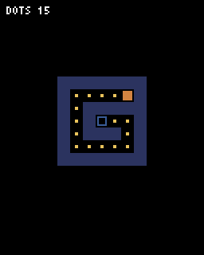

# 第5章 ドットとゴール：空白のマス全部にドットを置き、全部拾ったらゴールが開く

このゲームでは、通路のマス全部にドットが置いてあります。滑って通ったマスのドットを拾い、全部拾ったらゴールが開き、そこを通ればクリアです。つまり、**迷路のすべての通路を、少なくとも1回は通る** パズルになります。ここまで作ると、ちゃんと考えて解くパズルになります。迷路も、少し考えがいのあるものに変えます。



## コードを書く

変更が何か所かに分かれているので、全体を載せます。前の章から変わったのは、`MAP` の中身、`__init__` の `S` を探すループ、`self.clear`、`count_dots` メソッド、`move` メソッドの `while` の中、それに `draw` です。

```python
import pyxel

TILE = 8

MAP = [
    "#######",
    "#    S#",
    "# #####",
    "# #E  #",
    "# ### #",
    "#     #",
    "#######",
]


class App:
    def __init__(self):
        pyxel.init(128, 160, title="SLIDE MAZE")
        self.grid = [list(row) for row in MAP]
        self.h = len(self.grid)
        self.w = len(self.grid[0])
        self.ox = (128 - self.w * TILE) // 2
        self.oy = 16 + (120 - self.h * TILE) // 2
        for y in range(self.h):
            for x in range(self.w):
                if self.grid[y][x] == "S":
                    self.x = x
                    self.y = y
                    self.grid[y][x] = " "  # 立っているマスは拾ったことにする
                elif self.grid[y][x] == " ":
                    self.grid[y][x] = "."  # 空白のマスには全部ドットを置く
        self.clear = False  # クリアしたら True
        pyxel.run(self.update, self.draw)

    def is_wall(self, x, y):
        return self.grid[y][x] == "#"

    def count_dots(self):
        # 残っているドットの数をかぞえる
        n = 0
        for row in self.grid:
            n += row.count(".")
        return n

    def move(self, dx, dy):
        if self.clear:
            return
        while not self.is_wall(self.x + dx, self.y + dy):
            self.x += dx
            self.y += dy
            tile = self.grid[self.y][self.x]
            if tile == ".":
                self.grid[self.y][self.x] = " "  # ドットを拾う
            if tile == "E" and self.count_dots() == 0:
                self.clear = True  # ゴールが開いていればクリア
                break

    def update(self):
        if pyxel.btnp(pyxel.KEY_UP):
            self.move(0, -1)
        if pyxel.btnp(pyxel.KEY_DOWN):
            self.move(0, 1)
        if pyxel.btnp(pyxel.KEY_LEFT):
            self.move(-1, 0)
        if pyxel.btnp(pyxel.KEY_RIGHT):
            self.move(1, 0)

    def draw(self):
        pyxel.cls(0)
        for y in range(self.h):
            for x in range(self.w):
                tile = self.grid[y][x]
                px = self.ox + x * TILE
                py = self.oy + y * TILE
                if tile == "#":
                    pyxel.rect(px, py, TILE, TILE, 1)
                elif tile == ".":
                    pyxel.rect(px + 3, py + 3, 2, 2, 10)
                elif tile == "E":
                    if self.count_dots() == 0:
                        pyxel.rect(px + 1, py + 1, 6, 6, 11)  # 開いたゴール
                    else:
                        pyxel.rectb(px + 1, py + 1, 6, 6, 5)  # 閉じたゴール
        px = self.ox + self.x * TILE
        py = self.oy + self.y * TILE
        pyxel.rect(px + 1, py + 1, 6, 6, 9)

        pyxel.text(4, 4, f"DOTS {self.count_dots()}", 7)
        if self.clear:
            pyxel.rect(24, 64, 80, 24, 1)
            pyxel.text(52, 73, "CLEAR!", 10)


App()
```

この迷路は5手で解けます。まず自分で解いてみてください。

## 空白のマスを全部ドットにする

`S` を探すループに、2行足しました。

```python
        for y in range(self.h):
            for x in range(self.w):
                if self.grid[y][x] == "S":
                    self.x = x
                    self.y = y
                    self.grid[y][x] = " "  # 立っているマスは拾ったことにする
                elif self.grid[y][x] == " ":
                    self.grid[y][x] = "."  # 空白のマスには全部ドットを置く
```

迷路の中の空白 `" "` を、ドット `"."` に書きかえています。迷路を書くときにドットを1つずつ置かなくても、通路は全部ドットになります。

`S` のマスは、プレイヤーが最初から立っている場所なので、拾い済みということにして空白のままにします。`if` と `elif` を使っているので、`S` を空白に書きかえたマスが、同じ回のくり返しでドットにされることはありません。

## ドットを拾う＝迷路の文字を書きかえる

`move` の `while` の中で、1マス進むたびにそのマスを調べています。

```python
            tile = self.grid[self.y][self.x]
            if tile == ".":
                self.grid[self.y][self.x] = " "  # ドットを拾う
            if tile == "E" and self.count_dots() == 0:
                self.clear = True  # ゴールが開いていればクリア
                break
```

ドットのマスに来たら、そのマスを通路 `" "` に書きかえます。これが「拾う」です。第2章で迷路をリストにしておいたのは、このためでした。

滑っている途中のマスも1つずつ調べているので、止まらずに通り過ぎたマスのドットも拾えます。拾ったあとのマスは黒い通路に戻るので、まだ通っていないマスが一目でわかります。

## 残りのドットを数える

`count_dots` は、迷路の中に残っている `.` の数を返します。

```python
    def count_dots(self):
        # 残っているドットの数をかぞえる
        n = 0
        for row in self.grid:
            n += row.count(".")
        return n
```

`row.count(".")` は、リスト `row` の中に `"."` がいくつあるかを数える命令です。それを全部の行について足しています。

## ゴールは「ドットが0個なら」クリア

ゴールのマス `E` に来たとき、`count_dots()` が0ならクリアです。クリアしたことは `self.clear` という変数で覚えておきます。`self.clear` のように、状態を `True` と `False` で覚えておく変数を **フラグ** と呼びます。

クリアしたら `break` でくり返しを抜けて、その場で止まります。ドットが残っているときは、ゴールはただの通路と同じで、上を通り過ぎるだけです。

`if` を2つ並べた順番にも意味があります。先にドットを拾ってからゴールを調べているので、最後のドットのすぐ先にゴールがあっても、同じ1回の滑りでクリアできます。

クリアしたあとは `move` の最初の `if self.clear: return` で何もしなくなり、プレイヤーは動きません。

## 文字の中に数を入れる

`draw` では、残りのドット数を画面に出しています。

```python
pyxel.text(4, 4, f"DOTS {self.count_dots()}", 7)
```

文字列の前に `f` を付けると、`{ }` の中に書いた式の値が文字列に入ります。これを **f文字列** と呼びます。ドットが12個残っていれば `DOTS 12` と表示されます。

ゴールは、ドットが残っているあいだは暗い青の枠に、0個になると緑の四角に描き分けています。開いたかどうかが一目でわかるようにするためです。

## 試してみる：絶対に解けない迷路

`MAP` を次のように書きかえて、遊んでみてください。上から3行目の、左から3文字目の `#` を空白にして、くぼみを1つ作っただけです。

```python
MAP = [
    "#######",
    "#S    #",
    "## ## #",
    "#E    #",
    "#######",
]
```

どう動いても、くぼみのマスのドットが拾えません。このマスを通るには、上か下からまっすぐ滑ってくる必要があります。ところが、くぼみの真上と真下のマスはどちらも横向きの通路の途中にあり、そこでは止まれません。止まれないので、縦に曲がれないのです。

通路を全部通るこのゲームでは、どう滑っても通れないマスが1つでもあると、そのステージは絶対にクリアできません。自分で迷路を作るときは、すべてのマスに「ここはどこから滑ってきて通るのか」を確かめてください。これをコンピュータに確かめさせる方法は、第13章で紹介します。
