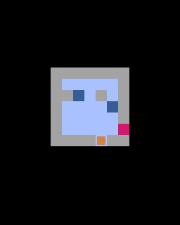

# 第5章 水に落ちたら元の場所へ：動く前の位置を覚えておく

凍った湖には、ところどころ凍っていない場所があります。うっかり滑りこむと、湖に落ちてしまいます。この章では、水のマス `~` を足し、落ちたら元の場所に戻るようにします。湖も、水のある新しいものに変えます。



## コードを書く

変更が何か所かに分かれているので、全体を載せます。前の章から変わったのは、`MAP` の中身、`self.splash`、`move` メソッド、`update` の最初、それに `draw` です。

```python
import pyxel

TILE = 8

MAP = [
    "#######",
    "#     #",
    "##~ # #",
    "#    ~#",
    "#     #",
    "#     E",
    "####S##",
]


class App:
    def __init__(self):
        pyxel.init(128, 160, title="ICE LAKE")
        self.grid = [list(row) for row in MAP]
        self.h = len(self.grid)
        self.w = len(self.grid[0])
        self.ox = (128 - self.w * TILE) // 2
        self.oy = 16 + (120 - self.h * TILE) // 2
        for y in range(self.h):
            for x in range(self.w):
                if self.grid[y][x] == "S":
                    self.x = x
                    self.y = y
                    self.grid[y][x] = " "
        self.clear = False
        self.splash = 0  # 水に落ちたあと、文字を出しておく残りフレーム数
        pyxel.run(self.update, self.draw)

    def is_rock(self, x, y):
        if x < 0 or x >= self.w or y < 0 or y >= self.h:
            return True
        return self.grid[y][x] == "#"

    def move(self, dx, dy):
        if self.clear:
            return
        start_x = self.x  # 落ちたときに戻る場所を覚えておく
        start_y = self.y
        while not self.is_rock(self.x + dx, self.y + dy):
            self.x += dx
            self.y += dy
            tile = self.grid[self.y][self.x]
            if tile == "~":
                # 水に落ちた！ 元の場所に戻す
                self.x = start_x
                self.y = start_y
                self.splash = 30
                return
            if tile == "E":
                self.clear = True
                break

    def update(self):
        if self.splash > 0:
            self.splash -= 1
        if pyxel.btnp(pyxel.KEY_UP):
            self.move(0, -1)
        if pyxel.btnp(pyxel.KEY_DOWN):
            self.move(0, 1)
        if pyxel.btnp(pyxel.KEY_LEFT):
            self.move(-1, 0)
        if pyxel.btnp(pyxel.KEY_RIGHT):
            self.move(1, 0)

    def draw(self):
        pyxel.cls(0)
        for y in range(self.h):
            for x in range(self.w):
                tile = self.grid[y][x]
                px = self.ox + x * TILE
                py = self.oy + y * TILE
                if tile == "#":
                    pyxel.rect(px, py, TILE, TILE, 13)
                elif tile == "E":
                    pyxel.rect(px, py, TILE, TILE, 8)
                elif tile == "~":
                    pyxel.rect(px, py, TILE, TILE, 5)  # 水（暗い青）
                else:
                    pyxel.rect(px, py, TILE, TILE, 6)
        px = self.ox + self.x * TILE
        py = self.oy + self.y * TILE
        pyxel.rect(px + 1, py + 1, 6, 6, 9)

        if self.splash > 0:
            pyxel.text(50, 4, "SPLASH!", 12)
        if self.clear:
            pyxel.rect(24, 64, 80, 24, 1)
            pyxel.text(52, 73, "CLEAR!", 10)


App()
```

この湖は4手で町に着けます。まず自分で解いてみてください。何度か落ちてみると、水の場所が頭に入ってきます。

## 落ちたら元の場所に戻す

`move` メソッドを見てみましょう。

```python
    def move(self, dx, dy):
        if self.clear:
            return
        start_x = self.x  # 落ちたときに戻る場所を覚えておく
        start_y = self.y
        while not self.is_rock(self.x + dx, self.y + dy):
            self.x += dx
            self.y += dy
            tile = self.grid[self.y][self.x]
            if tile == "~":
                # 水に落ちた！ 元の場所に戻す
                self.x = start_x
                self.y = start_y
                self.splash = 30
                return
            if tile == "E":
                self.clear = True
                break
```

滑り始める前に、今の位置を `start_x` と `start_y` に覚えておきます。滑っている途中で水のマスに入ったら、プレイヤーの位置を覚えておいた場所に戻して、`return` でメソッドを終わります。

水は、岩とちがって通り抜けられません。入ったとたんに落ちるので、水の手前で止まることもありません。「水の上を通る滑り方は全部だめ」と考えると、どの向きに滑れるかが見えてきます。

> **レイトン教授の「氷の湖」とのちがい**
> このゲームは、『レイトン教授と超文明Aの遺産』のナゾ「氷の湖」を参考にしています。ナゾは、湖に落ちないように町までの道順を考えるのが目的です。この教材では、何度も試しながらじっくり考えられるように、落ちたらその1手だけを取り消すことにしました。

## SPLASH! をしばらく表示する

落ちたことがわかるように、画面の上に「SPLASH!」と出します。ただ、`move` は1フレームの中で終わってしまうので、そのフレームだけ文字を出しても一瞬で消えてしまいます。

そこで、`self.splash` に「あと何フレーム表示するか」を入れておきます。落ちたときに30を入れ、`update` で毎フレーム1ずつ減らし、`draw` では0より大きいあいだだけ文字を出します。

```python
    def update(self):
        if self.splash > 0:
            self.splash -= 1
```

fps は30なので、30フレームはちょうど1秒です。「残り時間」を数で持って毎フレーム減らすやり方は、ゲームでよく使います。

## 試してみる：水を増やす

`MAP` の空白をいくつか `~` に書きかえて、遊んでみてください。水を増やしすぎると、どう滑っても町に着けない湖になります。たとえば、町のすぐ手前（湖の内側のとなり）のマスを水にすると、町に入るにはそのマスを通るしかないので、絶対に町に着けなくなります。

自分で湖を作るときは、町に入るための「最後の1手」がどこから来るのかを考えると作りやすくなります。解けるかどうかをコンピュータに確かめさせる方法は、第13章で紹介します。
