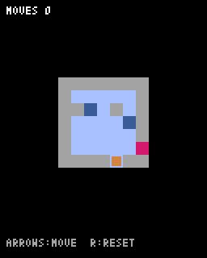

# 第6章 手数とやり直し：準備の処理を関数にまとめると、やり直しが1行で書ける

パズルとしては遊べるようになりましたが、まだ2つ足りないものがあります。何手かかったかがわからないことと、行き詰まったら最初からやり直せないことです。この章でその2つを足します。



## 準備の処理を load_level にまとめる

「最初からやり直す」とは、湖とプレイヤーをゲーム開始時の状態に戻すことです。開始時の準備は `__init__` に書いてありました。この部分を `load_level` という別のメソッドに移せば、やり直したいときに何度でも呼べます。

`__init__` を次のように短くし、そのすぐ下に `load_level` を作ります。

```python
    def __init__(self):
        pyxel.init(128, 160, title="ICE LAKE")
        self.splash = 0
        self.load_level()
        pyxel.run(self.update, self.draw)

    def load_level(self):
        # ステージを最初の状態にする（やり直しにも使う）
        self.grid = [list(row) for row in MAP]
        self.h = len(self.grid)
        self.w = len(self.grid[0])
        self.ox = (128 - self.w * TILE) // 2
        self.oy = 16 + (120 - self.h * TILE) // 2
        for y in range(self.h):
            for x in range(self.w):
                if self.grid[y][x] == "S":
                    self.x = x
                    self.y = y
                    self.grid[y][x] = " "
        self.moves = 0  # 手数
        self.clear = False
```

`load_level` の中身は、`__init__` にあった準備の処理とほとんど同じです。最後に、手数を数える `self.moves` を足しています。`self.splash` は、ステージをやり直しても関係ないので `__init__` に残しました。

`__init__` の中で、`self.load_level()` を `pyxel.run` より前に呼んでいることに注意してください。第1章で説明したとおり、`pyxel.run` より後ろは実行されません。

## 動けたときだけ手数を増やす

`move` メソッドを次のように書きかえます。

```python
    def move(self, dx, dy):
        if self.clear:
            return
        if self.is_rock(self.x + dx, self.y + dy):
            return  # 1マスも動けないときは手数にかぞえない
        start_x = self.x
        start_y = self.y
        while not self.is_rock(self.x + dx, self.y + dy):
            self.x += dx
            self.y += dy
            tile = self.grid[self.y][self.x]
            if tile == "~":
                self.x = start_x
                self.y = start_y
                self.splash = 30
                return  # 落ちた手も手数にかぞえない
            if tile == "E":
                self.clear = True
                break
        self.moves += 1
```

`while` に入る前に、となりが岩かどうかを1回だけ調べています。岩なら1マスも動けないので、手数を増やさずに `return` で抜けます。岩に向かってキーを押しても1手と数えないためです。

手数を1増やすのは、`while` が終わったあと、つまり落ちずに止まれたとき（または町に着いたとき）です。水に落ちたときは途中の `return` で抜けるので、手数は増えません。落ちた手は「なかったこと」になるからです。

## R キーでやり直す

`update` の最後に、次の2行を足します。

```python
        if pyxel.btnp(pyxel.KEY_R):
            self.load_level()
```

`load_level` を呼ぶだけで、湖も、プレイヤーの位置も、手数も、クリアのフラグも全部元に戻ります。準備の処理を1か所にまとめておいたので、やり直しの処理を新しく書く必要がありません。

## 手数を表示する

`draw` の最後の部分を次のように書きかえます。

```python
        pyxel.text(4, 4, f"MOVES {self.moves}", 7)
        if self.splash > 0:
            pyxel.text(50, 4, "SPLASH!", 12)
        pyxel.text(4, 148, "ARROWS:MOVE  R:RESET", 13)
        if self.clear:
            pyxel.rect(24, 64, 80, 24, 1)
            pyxel.text(52, 70, "CLEAR!", 10)
            pyxel.text(42, 78, f"{self.moves} MOVES", 7)
```

画面の上に手数と「SPLASH!」、下に操作の説明を出しています。クリアしたときは、何手でクリアしたかも表示します。

手数は、次のように文字の中に入れて表示しています。

```python
pyxel.text(4, 4, f"MOVES {self.moves}", 7)
```

文字列の前に `f` を付けると、`{ }` の中に書いた式の値が文字列に入ります。これを **f文字列** と呼びます。手数が3なら `MOVES 3` と表示されます。

完成コードは `code/step06/main.py` にあります。
