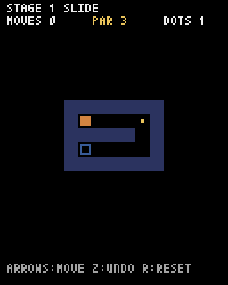

# 第8章 ステージを増やす：ステージは別ファイルにまとめ、番号で切りかえる

1つの迷路を解けるようになったので、ステージを5つに増やし、クリアしたら次へ進めるようにします。ここまで終わると、キーボードで遊べるゲームとしては完成です。



## ステージのデータを levels.py に分ける

ステージが増えると、迷路のデータだけでかなりの行数になります。`main.py` に全部書くと読みにくいので、`levels.py` という別のファイルに分けます。`main.py` と同じフォルダに作ってください。

ファイルの最初の部分はこうなっています。

```python
# ステージのデータ
#   "#" 壁  "." ドット  "S" スタート  "E" ゴール
# par は最短手数

LEVELS = [
    {
        "name": "SLIDE",
        "par": 3,
        "map": [
            "#######",
            "#S   .#",
            "##### #",
            "#E    #",
            "#######",
        ],
    },
    {
        "name": "TURN",
        ...（つづく）
]
```

5ステージすべてを含めた全体は `code/step08/levels.py` にあります。打ち込むのが大変なら、このファイルはコピーしてかまいません。

1つのステージは `{ }` で囲んだ **辞書** で表しています。辞書は「名前」と「値」の組をまとめる入れ物で、`level["name"]` のように名前で値を取り出せます。ここでは次の3つを入れています。

- `"name"`：ステージの名前
- `"par"`：最短手数
- `"map"`：迷路

`LEVELS` は、その辞書を並べたリストです。`LEVELS[0]` が1つ目のステージになります。

> **PAR はどうやって決めたのか**
> この5ステージは、このリポジトリの完成版のゲームから持ってきたものです。PAR の数字は、考えられる動き方をコンピュータに全部調べさせて求めています。自分で作ったステージの PAR を求める方法は、第13章で紹介します。

## main.py でステージを読みこむ

`main.py` の最初で、`levels.py` の `LEVELS` を使えるようにします。

```python
from levels import LEVELS
```

`from ファイル名 import 名前` で、別のファイルに書いた変数や関数を使えます。ファイル名の `.py` は付けません。ここまで `main.py` に書いていた `MAP = [...]` は、もう使わないので消してください。

`__init__` では、今のステージ番号を `self.stage` に覚えておきます。0番から数えます。

```python
    def __init__(self):
        pyxel.init(128, 160, title="SLIDE MAZE")
        self.stage = 0  # 今のステージ番号（0 から数える）
        self.load_level()
        pyxel.run(self.update, self.draw)
```

`load_level` の最初の部分を、`MAP` の代わりに `LEVELS[self.stage]` を使うように書きかえます。

```python
    def load_level(self):
        level = LEVELS[self.stage]
        self.grid = [list(row) for row in level["map"]]
```

## クリアしたら次のステージへ

次のステージへ進む `next_stage` メソッドを作ります。

```python
    def next_stage(self):
        if self.stage + 1 < len(LEVELS):
            self.stage += 1
            self.load_level()
```

`len(LEVELS)` はステージの数です。最後のステージでさらに番号を増やすと、`LEVELS[5]` という存在しないステージを読もうとして `IndexError` になります。それを防ぐために、次のステージがあるときだけ進むようにしています。

`update` の最初に、クリアしているときに Enter キーで次へ進む判定を足します。

```python
        if self.clear and pyxel.btnp(pyxel.KEY_RETURN):
            self.next_stage()
```

## PAR を表示する

`draw` の最後を書きかえて、ステージ名と PAR を表示します。

```python
        # 上の文字と、クリアしたときの表示
        level = LEVELS[self.stage]
        pyxel.text(4, 2, f"STAGE {self.stage + 1} {level['name']}", 7)
        pyxel.text(4, 9, f"MOVES {self.moves}", 7)
        pyxel.text(52, 9, f"PAR {level['par']}", 10)
        pyxel.text(92, 9, f"DOTS {self.count_dots()}", 7)
        pyxel.text(4, 148, "ARROWS:MOVE Z:UNDO R:RESET", 13)
        if self.clear:
            pyxel.rect(16, 60, 96, 36, 1)
            pyxel.text(52, 66, "CLEAR!", 10)
            pyxel.text(36, 75, f"MOVES {self.moves}  PAR {level['par']}", 7)
            if self.stage + 1 < len(LEVELS):
                pyxel.text(30, 86, "ENTER: NEXT STAGE", 6)
            else:
                pyxel.text(44, 86, "ALL CLEAR!", 6)
```

クリアしたときには、手数と PAR を並べて出しています。PAR と同じ手数でクリアできたら最短です。最後のステージをクリアしたら、「ALL CLEAR!」を表示します。

## 自分のステージを足してみる

`levels.py` の `LEVELS` に、自分で作ったステージを足してみてください。`"par"` がまだわからなければ、とりあえず `0` にしておいてかまいません。

ステージを作るときのコツをいくつか挙げておきます。

- 最初に「解き方」を決めてから、その道すじに合わせて壁を置くと作りやすい
- 止まれる場所（壁の手前）が少ないほど、考えどころが増える
- 一度入ると戻れない行き止まりがあると、手順をよく考えるようになる。UNDO があるので、意地悪すぎることはない

ここまでで、キーボードで遊べるパズルが完成しました。次の章からは、ゲームとしての手ざわりを良くしていきます。
