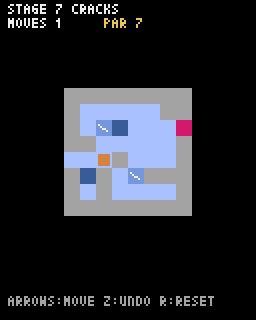

# 第10章 もろい氷：離れるときに水へ書きかえる

レイトン教授の「氷の湖」には、薄くてもろい氷が出てきます。乗っても通ってもかまいませんが、一度通ると割れてしまい、二度と使えません。この章では、このもろい氷を足して、ステージを10個にします。



| 文字 | 名前 | ルール |
| --- | --- | --- |
| `x` | もろい氷 | 乗っても通ってもよい。離れると割れて水 `~` になる |

もろい氷は、通る順番を考えさせる仕掛けです。ある道を先に通ってしまうと、あとでその道が使えなくなります。

## ステージを入れかえる

`levels.py` を `code/step10/levels.py` の内容に入れかえてください。前の5ステージに、もろい氷を使う5ステージが足してあります。

## 離れるマスがもろい氷なら、水にする

もろい氷は、プレイヤーがそのマスを **離れるとき** に割れます。上に止まっているあいだは、まだ割れません。

「離れるとき」とは、`update_move` で `self.x += self.dx` によって次のマスへ進む直前のことです。この時点では、`self.x` と `self.y` はまだ離れる前のマスを指しています。そこが `x` なら `~` に書きかえます。

```python
    def update_move(self):
        # 1フレーム分だけ進む
        self.offset += SPEED
        if self.offset < TILE:
            return
        # となりのマスに着いた
        self.offset = 0
        if self.grid[self.y][self.x] == "x":
            self.grid[self.y][self.x] = "~"  # 離れたもろい氷は割れて水になる
        self.x += self.dx
        self.y += self.dy
        tile = self.grid[self.y][self.x]
        if tile == "~":
            self.moving = False
            self.undo()  # 落ちたら、この手をなかったことにする
            self.splash = 30
            return
        if tile == "E":
            self.clear = True
            self.moving = False
            return
        if self.is_rock(self.x + self.dx, self.y + self.dy):
            self.moving = False  # 次が岩なら止まる
```

割れた氷を水 `~` に書きかえているので、水に落ちる処理は何も変えずにすみます。割れたあとのマスは、ふつうの水とまったく同じようにふるまいます。

## 落ちたら、割れた氷も元に戻る

もろい氷を割りながら滑って、その先で水に落ちたとします。このとき、割れた氷はどうなるでしょうか。

落ちたときに呼んでいる `undo` は、第7章で作ったとおり、動く前にコピーしておいた湖をまるごと元に戻します。そのため、この1手で割れた氷も、割れる前に戻ります。プレイヤーにとっても「落ちた手はなかったことになる」ので、わかりやすい動きになります。

### 試してみる：コピーをやめるとどうなるか

第7章で予告した実験をしてみましょう。`start_move` の中の次の行を、

```python
        grid_copy = [row[:] for row in self.grid]
```

一時的に、コピーしない形に変えます。

```python
        grid_copy = self.grid
```

もろい氷のあるステージで、もろい氷を通ってから Z キーで戻ってみてください。プレイヤーは戻るのに、割れた氷は水のままです。記録したはずの湖と今の湖が同じリストなので、氷が割れたときに記録のほうも一緒に書きかわってしまったのです。

試し終わったら、必ず元に戻しておいてください。

## 描く

`draw` で湖を描く部分に、もろい氷の描き方を足します。水を描く `elif` の下に続けてください。

```python
                elif tile == "x":
                    pyxel.rect(px, py, TILE, TILE, 12)  # もろい氷（青）
                    pyxel.line(px + 1, py + 2, px + 5, py + 5, 7)  # ひび
```

もろい氷は、ふつうの氷より濃い青（12）の四角に、ひびを表す白い線を1本入れています。

## 遊んでみる

6番目のステージ「THIN ICE」では、湖のまん中にもろい氷が1つあります。最短の6手で町に着く手順では、このもろい氷をちょうど1回だけ通ります。2回目に通ろうとすると、割れた穴に落ちてしまいます。

7番目からは、もろい氷の使い方しだいで、町へ行けなくなる（詰む）こともあります。そうなったら、UNDO で戻って別の順番を試してください。詰んだことをゲームに知らせてもらう方法は、第14章で紹介します。

> **仕掛けを自分で増やすには**
> 新しいマスを作るときは、そのマスで起きることが「着いたとき」か「離れたとき」かを考えると、`update_move` のどこに書けばいいかが決まります。たとえば「乗ると止まる雪だまり」なら着いたときに `self.moving = False` にする、「2回通ると割れる厚い氷」なら離れたときに文字を別の文字に変え、2回目で `~` にする、といった具合です。
