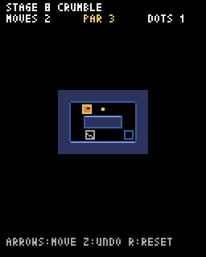

# 第11章 音と見た目：効果音は4行で作れ、壁はふちを描くだけで立体的に見える

ゲームの中身はできあがりました。この章では効果音を付け、壁とプレイヤーの見た目を整えます。仕組みの理解というより、手ざわりを良くする仕上げの章です。好みに合わせて自由に変えてください。



## 効果音を作る

Pyxel では、音を文字で書いて作れます。`__init__` の `pyxel.init` の下に、次の4行を足します。

```python
        # 音を作る: 音の高さ, 音色, 音量, エフェクト, 速さ
        pyxel.sounds[0].set("c2", "t", "4", "f", 10)  # 止まった音
        pyxel.sounds[1].set("a3", "s", "3", "f", 6)  # ドットを拾った音
        pyxel.sounds[2].set("c3e3g3c4", "t", "4", "n", 12)  # クリアの音
        pyxel.sounds[3].set("c3", "n", "3", "f", 8)  # 床が崩れる音
```

`pyxel.sounds[0].set(...)` は、0番の音を作る命令です。かっこの中の5つの値は次の意味です。

| 値 | 例 | 意味 |
| --- | --- | --- |
| 音の高さ | `"c3e3g3c4"` | ドレミを英語の音名（c d e f g a b）と高さの数字で並べる。`c3e3g3c4` は「ド・ミ・ソ・高いド」 |
| 音色 | `"t"` | `t` 三角波（やわらかい）、`s` 矩形波（ピコピコ）、`n` ノイズ（ザッ） |
| 音量 | `"4"` | 0〜7 |
| エフェクト | `"f"` | `n` なし、`f` だんだん小さくする |
| 速さ | `12` | 1音の長さ。大きいほどゆっくり |

鳴らすときは `pyxel.play(チャンネル, 音の番号)` と書きます。チャンネルは0〜3の4つあり、同じチャンネルで次の音を鳴らすと前の音は止まります。ドットの音と止まった音が重なっても両方聞こえるように、別のチャンネルを使います。

`update_move` の中の、ドットを拾ったところ・クリアしたところ・止まったところ・床が崩れたところで、それぞれ音を鳴らします。

```python
    def update_move(self):
        # 1フレーム分だけ進む
        self.offset += SPEED
        if self.offset < TILE:
            return
        # となりのマスに着いた
        self.offset = 0
        if self.grid[self.y][self.x] == "x":
            self.grid[self.y][self.x] = "#"  # 離れた崩れる床は壁になる
            pyxel.play(2, 3)
        self.x += self.dx
        self.y += self.dy
        tile = self.grid[self.y][self.x]
        if tile == ".":
            self.grid[self.y][self.x] = " "
            pyxel.play(1, 1)
        if tile == "E" and self.count_dots() == 0:
            self.clear = True
            self.moving = False
            pyxel.play(0, 2)
            return
        if tile == "o":
            self.moving = False  # ぬかるみでは止まる
        elif self.is_wall(self.x + self.dx, self.y + self.dy):
            self.moving = False  # 次が壁なら止まる
        if not self.moving:
            pyxel.play(0, 0)
```

最後の `if not self.moving:` は、このフレームで止まったら止まった音を鳴らす、という意味です。ぬかるみで止まった場合も、壁の手前で止まった場合も、この1か所で鳴らせます。

## 壁にふちを付ける

今の壁は紺色の四角を並べただけです。通路に面した辺にだけ明るい線を引くと、壁に厚みがあるように見えます。また、まわりがすべて壁のマス（迷路の外側）は描かないようにすると、迷路の形がはっきりします。

まず、迷路の外側を読んでもエラーにならないように、`tile_at` メソッドを作ります。迷路の外なら壁ということにしておきます。

```python
    def tile_at(self, x, y):
        # 迷路の外は壁ということにする
        if 0 <= x < self.w and 0 <= y < self.h:
            return self.grid[y][x]
        return "#"
```

これを使って、壁を描く `draw_wall` メソッドを作ります。

```python
    def draw_wall(self, x, y, px, py):
        # まわりが全部壁なら何も描かない（迷路の外側を暗くする）
        is_open = False
        for ny in range(y - 1, y + 2):
            for nx in range(x - 1, x + 2):
                if self.tile_at(nx, ny) != "#":
                    is_open = True
        if not is_open:
            return
        pyxel.rect(px, py, TILE, TILE, 1)
        # 通路に面した辺にふちをつける
        if self.tile_at(x, y - 1) != "#":
            pyxel.line(px, py, px + 7, py, 12)
        if self.tile_at(x, y + 1) != "#":
            pyxel.line(px, py + 7, px + 7, py + 7, 5)
        if self.tile_at(x - 1, y) != "#":
            pyxel.line(px, py, px, py + 7, 5)
        if self.tile_at(x + 1, y) != "#":
            pyxel.line(px + 7, py, px + 7, py + 7, 5)
```

上の辺には明るい青（12）、ほかの辺には暗い青（5）の線を引いています。上から光が当たっているように見せるためです。

`draw` の中で壁を描いていた `pyxel.rect(px, py, TILE, TILE, 1)` を、`self.draw_wall(x, y, px, py)` に置きかえます。

## ゴールを点滅させ、プレイヤーに目を付ける

開いたゴールは、点滅させると目立ちます。

```python
                        # 開いたゴールは点滅させる（frame_count はフレームの通し番号）
                        color = 11 if pyxel.frame_count % 30 < 15 else 3
                        pyxel.rect(px + 1, py + 1, 6, 6, color)
```

`pyxel.frame_count` は、ゲームが始まってから何フレーム目かを表す数です。30で割った余りが15より小さいあいだは明るい色、それ以外は暗い色にしているので、30フレームごとに点滅します（fps=60 なので、1秒に2回）。

プレイヤーには、黄色いふちと、進む向きを見る目を付けます。

```python
        pyxel.rectb(px + 1, py + 1, 6, 6, 10)
        # 目は進む向きを見る
        pyxel.pset(px + 3 + self.dx, py + 3 + self.dy, 0)
        pyxel.pset(px + 4 + self.dx, py + 3 + self.dy, 0)
```

`pyxel.pset` は1ドットだけ打つ命令です。目の位置を `dx` と `dy` のぶんだけずらすと、滑る向きを見ているように見えます。ゲーム開始時に下を見ているように、`load_level` の `self.dy = 0` を `self.dy = 1` に変えておきます。
