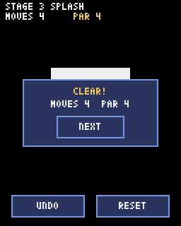

# 第12章 スマホで遊ぶ：タッチはマウスとして届くので、指が動いた向きを調べる

最後に、スマホでも遊べるようにします。スマホには矢印キーがないので、画面を指でなぞる **スワイプ** で動かし、UNDO とやり直しは画面のボタンで行うようにします。そのあと、ゲームを Web ページにしてスマホのブラウザで開く方法を説明します。



## タッチはマウスの左ボタンとして届く

Pyxel のゲームをブラウザで動かすと、画面へのタッチは「マウスの左ボタン」として届きます。指を置くとボタンを押したことになり、指を動かすとマウスが動き、指を離すとボタンを離したことになります。そのため、パソコンのマウスでドラッグして試せるように作れば、そのままスマホでも動きます。

使う命令は次の5つです。

- `pyxel.btnp(pyxel.MOUSE_BUTTON_LEFT)`：押した（指を置いた）瞬間だけ True
- `pyxel.btn(pyxel.MOUSE_BUTTON_LEFT)`：押している（指を置いている）あいだ True
- `pyxel.btnr(pyxel.MOUSE_BUTTON_LEFT)`：離した瞬間だけ True
- `pyxel.mouse_x`、`pyxel.mouse_y`：今のマウス（指）の位置

## スワイプとタップを見分ける

指を置いた場所を覚えておき、そこから5ドット以上動いたらスワイプとみなします。横と縦のうち大きく動いたほうを向きにします。動かさずに離したら、それはタップです。

ファイルの最初に、スワイプの距離と、画面のボタンの位置を書きます。ボタンは `(名前, x, y, 幅, 高さ)` のタプルで表します。

```python
SWIPE = 5  # これだけ指を動かしたらスワイプとみなす

# 画面のボタン: (名前, x, y, 幅, 高さ)
UNDO_BUTTON = ("UNDO", 8, 138, 52, 16)
RESET_BUTTON = ("RESET", 68, 138, 52, 16)
NEXT_BUTTON = ("NEXT", 40, 82, 48, 16)
```

`__init__` には、タッチの状態を覚える変数を足します。

```python
        self.touch_start = None  # 指を置いた場所
        self.swiped = False
        self.swipe = None  # このフレームのスワイプの向き (dx, dy)
        self.tap = None  # このフレームでタップされた場所 (x, y)
```

タッチを調べる `update_touch` メソッドを作ります。

```python
    def update_touch(self):
        # スマホのタッチは、Pyxel ではマウスの左ボタンとして届く
        self.swipe = None
        self.tap = None
        mx = pyxel.mouse_x
        my = pyxel.mouse_y
        if pyxel.btnp(pyxel.MOUSE_BUTTON_LEFT):
            self.touch_start = (mx, my)
            self.swiped = False
        if self.touch_start and pyxel.btn(pyxel.MOUSE_BUTTON_LEFT) and not self.swiped:
            dx = mx - self.touch_start[0]
            dy = my - self.touch_start[1]
            if abs(dx) >= SWIPE or abs(dy) >= SWIPE:
                # 横と縦、大きく動いたほうの向きにする
                if abs(dx) > abs(dy):
                    self.swipe = (1 if dx > 0 else -1, 0)
                else:
                    self.swipe = (0, 1 if dy > 0 else -1)
                self.swiped = True  # 1回のタッチで1手だけ
        if pyxel.btnr(pyxel.MOUSE_BUTTON_LEFT):
            if self.touch_start and not self.swiped:
                self.tap = self.touch_start  # 動かさずに離したらタップ
            self.touch_start = None
```

`self.swiped` は、1回のタッチでスワイプを1回だけ受けつけるためのフラグです。これがないと、指を置いたまま動かし続けたときに、毎フレームのようにスワイプが起きてしまいます。

`1 if dx > 0 else -1` は、「`dx` が正なら1、そうでなければ-1」という意味の短い書き方です。

## ボタンがタップされたかを調べる

タップされた場所がボタンの四角の中にあるかを調べるのが `tapped` です。

```python
    def tapped(self, button):
        # ボタンの四角の中がタップされたか
        if self.tap is None:
            return False
        name, x, y, w, h = button
        tx, ty = self.tap
        return x <= tx < x + w and y <= ty < y + h
```

x がボタンの左端から右端までのあいだにあり、y が上端から下端までのあいだにあれば、四角の中です。`x <= tx < x + w` のように、Python では不等号を2つつなげて書けます。

## update で使う

`update` の最初で `update_touch` を呼び、スワイプがあれば `start_move` を、ボタンがタップされたら UNDO ややり直しを呼びます。

```python
    def update(self):
        self.update_touch()
        if self.splash > 0:
            self.splash -= 1
        if self.moving:
            self.update_move()
            return  # 滑っているあいだはキーを受けつけない
        if self.clear and (pyxel.btnp(pyxel.KEY_RETURN) or self.tapped(NEXT_BUTTON)):
            self.next_stage()
            return
        if pyxel.btnp(pyxel.KEY_UP):
            self.start_move(0, -1)
        if pyxel.btnp(pyxel.KEY_DOWN):
            self.start_move(0, 1)
        if pyxel.btnp(pyxel.KEY_LEFT):
            self.start_move(-1, 0)
        if pyxel.btnp(pyxel.KEY_RIGHT):
            self.start_move(1, 0)
        if self.swipe:
            self.start_move(self.swipe[0], self.swipe[1])
        if pyxel.btnp(pyxel.KEY_R) or self.tapped(RESET_BUTTON):
            self.load_level()
        if pyxel.btnp(pyxel.KEY_Z) or self.tapped(UNDO_BUTTON):
            self.undo()
```

ボタンの描画は `draw_button` にまとめ、`draw` から UNDO・RESET・NEXT の3つのボタンを描いています。キー操作の説明の文字は、ボタンを置いたので消しました。このあたりは完成コード `code/step12/main.py` を見てください。

ここまでできたら、パソコンで実行して、マウスでドラッグして動くこと、ボタンをクリックして UNDO とやり直しができることを確かめてください。

## Web ページにする

Pyxel には、ゲームを1つの HTML ファイルにする機能があります。ターミナルで `slide_maze` フォルダの **1つ上** のフォルダに移動して、次の2つを実行します。

```
pyxel package slide_maze slide_maze/main.py
pyxel app2html slide_maze.pyxapp
```

1つ目で、フォルダの中身をまとめた `slide_maze.pyxapp` ができます。2つ目で、それを埋めこんだ `slide_maze.html` ができます。この HTML ファイルをパソコンのブラウザで開くと、ゲームが動きます。Pyxel の本体はインターネットから読みこまれるので、ネットにつながっている必要があります。最初に「CLICK TO START」と出て、クリックするとゲームが始まります。音を鳴らすには一度クリックやタッチが必要、というブラウザの決まりがあるためです。ファイルを直接開いてうまく動かないときは、次に説明する GitHub Pages に置いてから試してください。

## スマホで開くには、インターネット上に置く

スマホで遊ぶには、HTML ファイルをインターネット上のどこかに置いて、スマホのブラウザからその URL を開く必要があります。無料で使える方法の1つが **GitHub Pages** です。

1. GitHub で新しいリポジトリを作る（公開設定は Public）
2. `slide_maze.html` の名前を `index.html` に変えて、リポジトリにアップロードする
3. リポジトリの Settings → Pages で、Branch に `main` を選んで保存する
4. 数分待つと `https://ユーザー名.github.io/リポジトリ名/` で開けるようになる

GitHub の無料プランでは、Pages を使えるのは Public（だれでも見られる）リポジトリだけです。また、GitHub は13歳以上でないとアカウントを作れません。使うときは、保護者や先生と相談してください。

## 「Script error.」が出て操作できないとき

スマホのブラウザによっては、画面の左上に「Script error.」と出て、タッチが効かなくなることがあります。ブラウザやアプリが自分で読みこんだスクリプトのエラーを、Pyxel がゲームのエラーと区別できずに画面全体に表示してしまうのが原因です（このリポジトリのゲームでも起きました）。

`slide_maze.html` をテキストエディタで開き、1行目の `<!doctype html>` のすぐ下に、次の内容を書き足すと直ります。

```html
<style>
  #pyxel-error-overlay { pointer-events: none !important; }
</style>
<script>
  window.addEventListener("error", (e) => {
    if (!e.error && (!e.message || e.message === "Script error.")) {
      e.stopImmediatePropagation();
    }
  }, true);
</script>
```

`<style>` の部分は、エラーの表示が出てもタッチをゲームに通す設定です。`<script>` の部分は、中身がわからない「Script error.」だけを、Pyxel に届く前に止めます。ゲーム自体のエラーはこれまでどおり表示されます。

これで、パソコンでもスマホでも遊べる氷の湖パズルの完成です。
