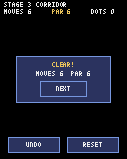

# Pyxel でつくる スライド迷路パズル

Python のゲームエンジン「Pyxel（ピクセル）」を使って、壁にぶつかるまで滑って進む迷路パズルを自分の手で作る教材です。最後まで進めると、パソコンでもスマホでも遊べるゲームになります。

## ゲームのルール

- 上下左右のどれかに動くと、壁にぶつかるまで止まらずに滑る
- 黄色いドットを全部拾うと、ゴールが開く
- 開いたゴールを通ればクリア
- 少ない手数でクリアするほどよい。そのステージの最短手数を **PAR（パー）** と呼ぶ

時間制限も敵もありません。「どの順に滑れば全部拾えるか」をじっくり考えるゲームです。

## この教材を読む人

Python で `print`、変数、`if`、`for`、リスト、`def`（関数）を少し書いたことがあれば読めます。`class` や `self` は知らなくてかまいません。第1章で、このゲームに必要なぶんだけ説明します。

## 進め方：1章ごとに打ち込み、動かしてから次へ

各章では前の章のプログラムに少しずつ書き足していきます。章の終わりで必ず実行し、説明どおりに動くのを確かめてから次に進んでください。

各章の完成コードは `code/step01/main.py` から `code/step12/main.py` に置いてあります。動かないときは自分のコードと見比べてください。コピーして貼りつけても動きますが、自分で打ち込んだほうが、どこに何を書いたかが頭に残ります。

**第1〜8章は順番に読んでください。** ここまでで、キーボードで遊べるパズルが一通りできあがります。第9〜12章では、アニメーション・新しい仕掛け・音・スマホ対応を足していきます。この4章も前の章のコードに積み上げる形なので順番に進みますが、どこで止めてもゲームとしては遊べます。第13章はおまけで、コンピュータに最短手数を探させます。

## 目次

| 章 | 内容 | できること |
| --- | --- | --- |
| [第0章 準備](00_junbi.md) | Python と Pyxel を入れる | プログラムを動かせる |
| [第1章 画面を出す](01_gamen.md) | ウィンドウを開いて文字と四角を描く | `update` と `draw` のしくみがわかる |
| [第2章 迷路を描く](02_meiro.md) | 文字で書いた迷路を絵にする | `grid[y][x]` で1マスを取り出せる |
| [第3章 プレイヤーを動かす](03_ugoku.md) | 矢印キーで1マスずつ動く | 壁を調べてから動ける |
| [第4章 壁まで滑らせる](04_suberu.md) | `if` を `while` に変える | 滑って動く |
| [第5章 ドットとゴール](05_dot_goal.md) | ドットを拾い、ゴールでクリア | パズルとして遊べる |
| [第6章 手数とやり直し](06_tesu.md) | 手数を数え、R キーで最初から | 準備を関数にまとめられる |
| [第7章 1手戻す](07_undo.md) | Z キーで1手前に戻る | リストのコピーの落とし穴がわかる |
| [第8章 ステージを増やす](08_stage.md) | 5ステージを順に遊ぶ | 別ファイルのデータを読みこめる |
| [第9章 滑るアニメーション](09_anime.md) | なめらかに滑らせる | 処理を何フレームかに分けられる |
| [第10章 ぬかるみと崩れる床](10_shikake.md) | 新しいマスを2種類足す | 仕掛けを自分で増やせる |
| [第11章 音と見た目](11_oto.md) | 効果音と、立体的な壁 | 音を作れる |
| [第12章 スマホで遊ぶ](12_sumaho.md) | スワイプとボタンで操作、Web公開 | スマホで遊べる |
| [第13章 おまけ：最短手数を探す](13_solver.md) | 幅優先探索で PAR を求める | 自作ステージを検証できる |
| [付録](appendix.md) | 困ったとき・用語集・色番号 | — |

## 困ったときは

エラーが出たら、まず [付録の「困ったとき」](appendix.md#困ったとき) を見てください。よくあるエラーと直し方をまとめてあります。エラーメッセージは、いちばん下の行に原因が書いてあることがほとんどです。

なお、このリポジトリの `game/` フォルダには、ステージ選択やセーブ機能まで入った完成版があります。教材を最後まで進めたあとに読むと、同じゲームを別の書き方で作った例として参考になります。
