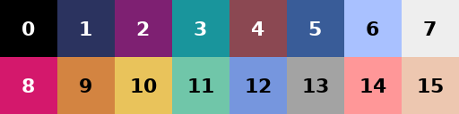

# 付録

## 困ったとき

エラーが出たら、メッセージのいちばん下の行を見てください。エラーの種類と原因が書いてあります。その少し上には `line 42` のように、エラーが起きた行の番号も出ています。

### `ModuleNotFoundError: No module named 'pyxel'`

Pyxel が入っていないか、Pyxel を入れた Python とは別の Python で実行しています。`python -m pip install pyxel` と打つと、`python` コマンドで動く Python に確実に入ります（Mac では `python3 -m pip install pyxel`）。

### `ModuleNotFoundError: No module named 'levels'`

`levels.py` が `main.py` と同じフォルダにないか、ターミナルの今いる場所が違います。`cd` でそのフォルダに移動してから実行してください。

### `IndentationError`

字下げがずれています。エラーの行と、その前後の行の字下げをそろえてください。タブとスペースが混ざっていることもよくあります。

### `IndexError: list index out of range`

リストの範囲の外を読もうとしています。このゲームでは、たいてい次のどれかです。

- `is_rock` で、湖の外かどうかを先に調べていない（第3章）
- 湖の行の長さがそろっていない（第2章）
- `self.grid[y][x]` を `self.grid[x][y]` と書いている（第2章）

### `AttributeError: 'App' object has no attribute 'x'`

`self.x` を作る前に使おうとしています。`self.x = ...` の行があるか、`__init__` の中で `pyxel.run` より前に実行されているかを確かめてください。`pyxel.run` より後ろに書いた行は実行されません（第1章）。`self.` を付け忘れて、ふつうの変数にしてしまっていることもあります。

### `NameError: name 'LEVELS' is not defined`

`from levels import LEVELS` の行を書き忘れています（第8章）。

### 実行しても何も起きない、ウィンドウがすぐ閉じる

ファイルのいちばん下に `App()` がないと、ゲームが始まりません。字下げせずに、行の先頭から書いてください。

### キーを押しても動かない

ゲームのウィンドウをクリックして、選ばれた状態にしてから押してください。`btnp` の中のキーの名前（`pyxel.KEY_UP` など）の書き間違いも確かめます。

### 画面が固まって動かなくなった

`while` のくり返しが終わらなくなっている可能性があります。ターミナルで Ctrl キーを押しながら C を押すと止まることがあります。止まらなければ、ターミナルごと閉じてください。`while` の中で `self.x` や `self.y` が変わっているか、`is_rock` が湖の外を岩として扱っているかを確かめてください。

### UNDO しても、割れた氷が戻らない

湖をコピーせずに記録しています。`grid_copy = [row[:] for row in self.grid]` になっているか確かめてください（第7章・第10章）。

### 町に着いてもクリアにならない、町を通り過ぎてエラーになる

`move`（第9章からは `update_move`）の中で、町 `"E"` を調べる `if` があるか、その中で `break`（第9章からは `self.moving = False`）しているかを確かめてください（第4章）。

### 水に落ちたのに元の場所に戻らない

水 `"~"` を調べる `if` が、町を調べる `if` より前にあるか、落ちたあとに `return` しているかを確かめてください（第5章）。第7章からは、落ちたときに `self.undo()` を呼んでいるかも確かめます。

### どう動いても町に着けない

町のすぐ手前（湖の内側のとなり）が水になっていないか、町の正面の列に止まれる場所があるかを確かめてください（第5章・第14章）。`solver.py` で解けるかどうかを調べることもできます（第13章）。

### 画面に日本語が出ない

Pyxel に最初から入っている文字は英数字だけです。画面の文字は英語で書きます。

### スマホで「Script error.」と出て操作できない

第12章の最後を見てください。

## 用語集

| 用語 | 意味 | 初出 |
| --- | --- | --- |
| フレーム | 画面を1回描きかえる単位。パラパラ漫画の1枚 | 第1章 |
| fps | 1秒あたりのフレーム数。Pyxel では指定しなければ30 | 第9章 |
| ドット（ピクセル） | 画面を作る小さな点。Pyxel の画面は横128×縦160ドット | 第1章 |
| 座標 | 画面の位置を表す (x, y)。左上が (0, 0)、y は下向きに増える | 第1章 |
| クラス | 変数とメソッドをひとまとめにする箱。このゲームでは `App` | 第1章 |
| メソッド | クラスの中に書いた関数 | 第1章 |
| self | 「このゲーム自身」。`self.` を付けた変数はフレームをまたいで残る | 第1章 |
| リスト内包表記 | `[list(row) for row in MAP]` のように、for を1行で書いてリストを作る書き方 | 第2章 |
| インデックス | リストの何番目かを表す番号。0から数える | 第2章 |
| フラグ | 状態を True / False で覚えておく変数。`self.clear` など | 第4章 |
| f文字列 | `f"MOVES {self.moves}"` のように、文字列の中に値を入れる書き方 | 第6章 |
| タプル | `( )` で値をまとめたもの。あとから中身を変えられない | 第7章 |
| スライス | `row[:]` のように、リストの一部を切り出すこと。ここではコピーに使った | 第7章 |
| UNDO | 1手前に戻すこと | 第7章 |
| 辞書 | 名前と値の組をまとめる入れ物。`level["name"]` のように使う | 第8章 |
| モジュール | 別のファイルに書いたプログラム。`import` で使う | 第8章 |
| PAR | そのステージの最短手数 | 第8章 |
| スワイプ／タップ | 画面を指でなぞる操作／軽く触れて離す操作 | 第12章 |
| 局面 | プレイヤーの位置と、湖のようす（どのもろい氷が割れたか）をまとめたもの | 第13章 |
| 幅優先探索 | 手数の少ない局面から順に調べて、最短の手順を見つける方法 | 第13章 |
| 集合（set） | 同じ値を2つ持たない入れ物。入っているかを調べるのが速い | 第13章 |
| 詰み | まだ動けるのに、どう動いてももう町に行けない局面 | 第14章 |
| 迷い度 | でたらめに動いたときに町に着くまでにかかる平均手数 ÷ 最短手数 | 第14章 |

## 色番号表

Pyxel で使える色は0〜15の16色です。

| 番号 | 色 | この教材での使いみち |
| --- | --- | --- |
| 0 | 黒 | 背景 |
| 1 | 紺 | ボタン、画面上の帯 |
| 2 | 紫 | |
| 3 | 青緑 | |
| 4 | 茶 | 家のドア |
| 5 | 暗い青 | 水、岩の影 |
| 6 | 水色 | 氷 |
| 7 | 白 | 文字、雪の岸、氷のきらめき |
| 8 | 赤 | 町（第2〜10章）、家の屋根、STUCK |
| 9 | オレンジ | プレイヤー |
| 10 | 黄 | PAR、CLEAR |
| 11 | 緑 | |
| 12 | 青 | もろい氷、波、ボタンの枠 |
| 13 | 灰 | 岩、操作の説明 |
| 14 | ピンク | |
| 15 | 肌色 | 家の壁 |
